# Laboratorio 4 - Comunicaciones de Datos

## 1.  a) Clasificación de las redes según su alcance

Las redes pueden clasificarse según el área geográfica o el alcance que cubren. Están clasificadas de la siguiente forma: 
**
**PAN → LAN → MAN → WAN**
**
  
  - PAN — Personal Area Network: Red de Área Personal. Es una red de alcance muy reducido alrededor de una persona. Un ejemplo típico es una conexión Bluetooth entre dispositivos personales.
  - LAN — Local Area Network: Red de Área Local.Abarca una zona relativamente limitada, como una oficina, un edificio o un campus. Se caracteriza por altas velocidades de transmisión y baja latencia. Cisco define una LAN como una colección de dispositivos conectados en una ubicación física limitada. 
  - MAN — Metropolitan Area Network: Red de Área Metropolitana. Cubre un área geográfica más amplia que una LAN, como una ciudad o un área metropolitana. Se utiliza para interconectar varias LANs dentro de la misma región. IBM la describe como una red mayor que una LAN pero menor que una WAN.
  - WAN — Wide Area Network: Red de Área Amplia. Se extiende sobre grandes distancias geográficas, como países o continentes. Internet es el ejemplo más conocido de una WAN, permitiendo la comunicación entre redes locales y metropolitanas a nivel global.
  
## 1.  b) VLAN: Virtual Local Area Network (Red de Área Local Virtual). 

Una VLAN permite dividir lógicamente una red física en diferentes redes independientes.

                 SWITCH
                │
                ┌─────────────┼─────────────┐
                │             │             │
              VLAN 10       VLAN 20       VLAN 99
              Turistas      Business       Admin

Aunque todos los dispositivos estén conectados físicamente al mismo switch, las VLAN permiten separarlos lógicamente. Cisco describe las VLAN como una forma de segmentar la red y agrupar dispositivos de acuerdo con necesidades administrativas.

_¿Cómo se clasifican las VLAN?_
Según su utilización se pueden diferenciar distintos tipos de VLAN:
*   Data VLAN: tráfico de usuarios.
*   Voice VLAN: tráfico de voz/telefonía IP.
*   Management VLAN: administración de dispositivos.
*   Native VLAN: VLAN cuyo tráfico se transmite sin etiqueta en un trunk 802.1Q.
   
## 1. c) IEEE 802.1Q 
Es el estándar utilizado para identificar VLANs mediante etiquetado de tramas Ethernet, especialmente cuando varias VLAN atraviesan un enlace trunk.
Un enlace trunk es un enlace entre dispositivos de red que permite transportar tráfico de varias VLAN simultáneamente por un mismo cable/enlace físico.El trunk permite que por el mismo cable entre Switch 1 y Switch 2 viajen las VLAN 10, 20, 99, etc. ¿Cómo sabe el switch a qué VLAN pertenece cada trama? **Mediante 802.1Q.**. Cuando una trama atraviesa un enlace trunk, el switch puede agregarle una etiqueta (tag) que indica a qué VLAN pertenece.

## 1. d) Tagging
Es el proceso mediante el cual se agrega, a una trama Ethernet, información que permite identificar la VLAN a la que pertenece. El switch receptor utiliza ese identificador para saber que la trama pertenece a VLAN 10.
El estándar 802.1Q inserta un tag de 4 bytes en la trama Ethernet; la VLAN nativa es una excepción habitual, ya que su tráfico puede circular sin tag por el trunk.

## 2. a) Packet Tracer.

  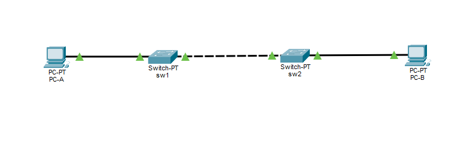

## 2. b) Configuración Inicial.

  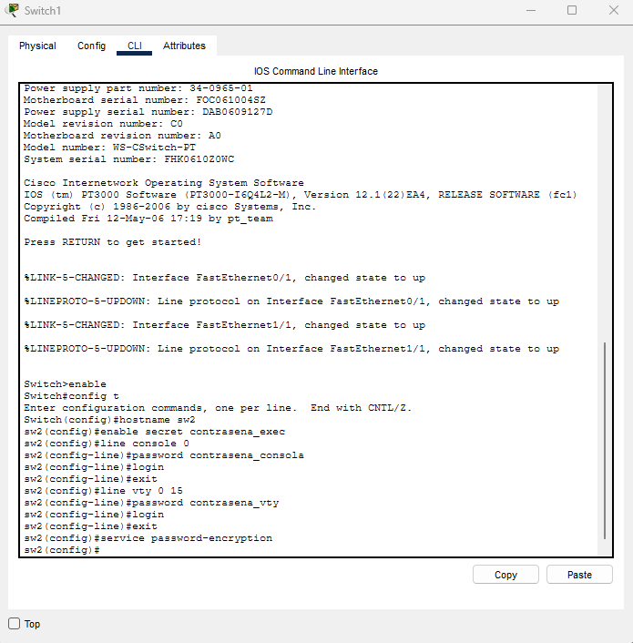

## 2. c) y d) Configuración de VLAN.

  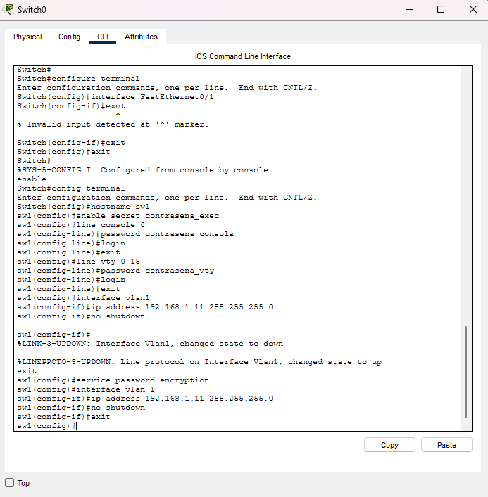

## 2. g) Test de la comunicación entre las PC

  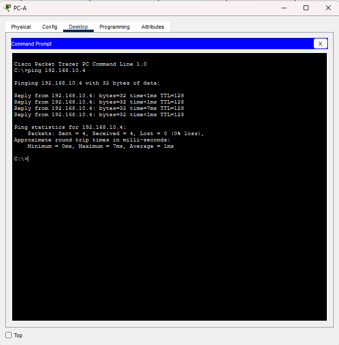

## 2. i) Lista de VLANs
Como se puede observar en la imagen la VLAN por defecto es la 1 (default).

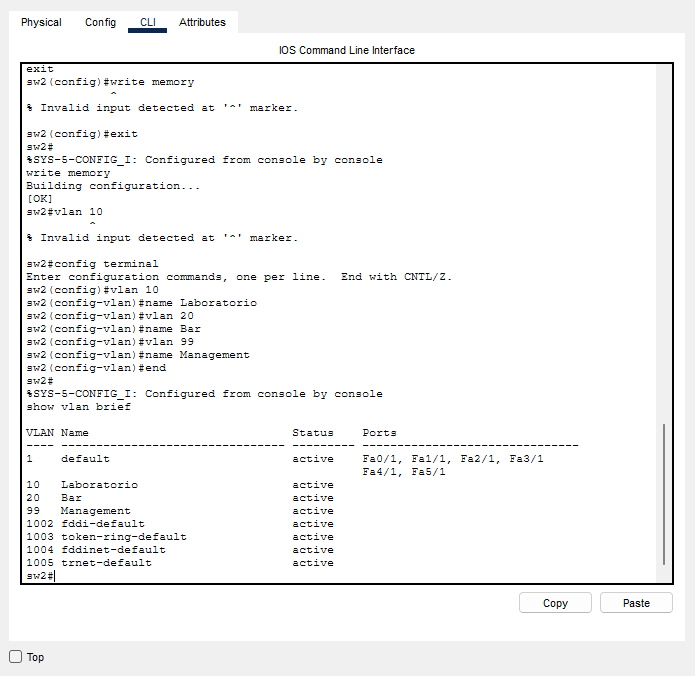

## 2. j-m) VLAN Laboratorio, VLAN Management y estado de las interfaces
Luego de que se realizaran las correspondientes configuraciones, se puede observar el estado final de las diferentes vlans e interfaces. 
La imagen es de sw1 pero también se aplicó la misma configuración a sw2 (f0/18 en lugar de f0/06)

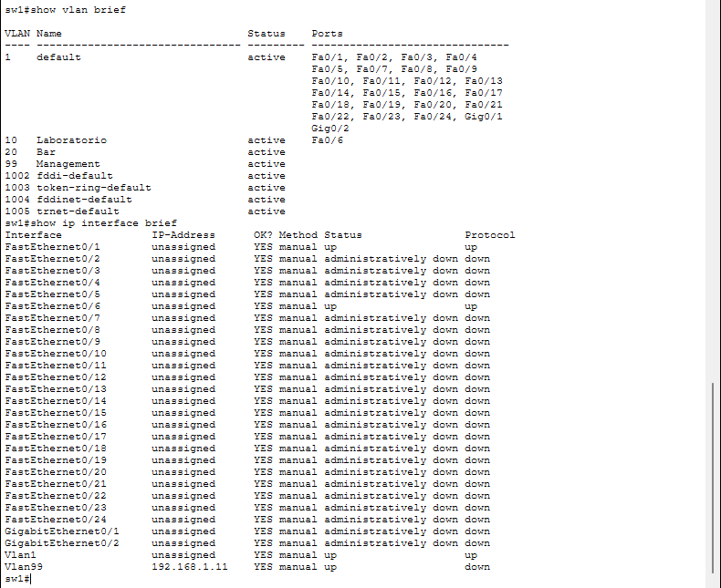

## 2. n) Verificación de conectividad 

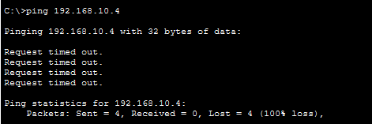

La conexión en las PC falló. A pesar de que tanto PC-A como PC-B pertenecen al mismo rango de red (192.168.10.0/24) y están asignadas a la misma VLAN (VLAN 10 - Laboratorio), se encuentran conectadas a switches físicamente distintos (sw1 y sw2). La razón del fallo radica en que el puerto de enlace entre ambos switches (FastEthernet0/1) se encuentra por defecto en modo acceso (Access Mode) perteneciendo a la VLAN 1. Al no estar configurado como un enlace troncal (Trunk), el switch sw1 descarta o no puede enviar las tramas etiquetadas con la VLAN 10 hacia el switch sw2.

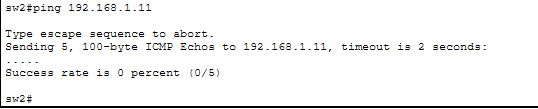

La conexión entre sw1 y sw2 también falló. En los incisos anteriores se migró la Interfaz Virtual del Switch (SVI de gestión) desde la VLAN 1 hacia la VLAN 99 (Management), asignando las direcciones IP 192.168.1.11 a sw1 y 192.168.1.12 a sw2. Al intentar hacer un ping entre los switches, este vuelve a fallar por la misma razón: el puerto de interconexión F0/1 no transporta el tráfico de la VLAN 99 porque sigue operando como puerto de acceso en la VLAN 1. Por lo tanto, los dominios de difusión de gestión en ambos switches se encuentran aislados entre sí.

## 3 Topología y consideraciones de cableado

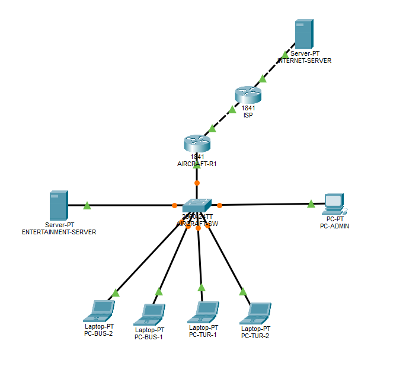

El diseño contempla la coexistencia de tres servicios definidos: la clase Turista, la clase Business y el área de Administración. Cada una de estas partes exige niveles diferenciados de acceso a los recursos locales y a Internet. Para llevar a cabo esta solución, se ha optado por una topología física centralizada en un switch principal denominado SW-Avion, conectado a un router central denominado AIRCRAFT-R1, el cual gestiona el tráfico interno y se conecta externamente al router del proveedor de servicios de Internet (ISP).
Durante el proceso de interconexión física se prestó especial atención a los tipos de medios empleados. Debido a que las conexiones entre el router AIRCRAFT-R1 y el router ISP, así como entre el ISP y el servidor de Internet, se realizan de manera directa entre dispositivos que pertenecen a la misma categoría física (interfaces MDI), fue imprescindible utilizar cableado cruzado (Copper Cross-Over). Por otro lado, la vinculación entre los equipos clientes, el servidor local de entretenimiento y el switch se realizó mediante cableado directo estandarizado.

##  Esquema de Direccionamiento IP

La VLAN 10 (Turista) utiliza la subred 10.10.10.0/24 con gateway 10.10.10.1. La VLAN 20 (Business) utiliza la subred 10.10.20.0/24 con gateway 10.10.20.1. La VLAN 99 (Admin) utiliza la subred 10.10.99.0/24 con gateway 10.10.99.1 y aloja al servidor local en la IP fija 10.10.99.10. El enlace WAN punto a punto entre AIRCRAFT-R1 e ISP se configuró en la red 200.0.0.0/30, asignando las direcciones 200.0.0.1 al router de la aeronave y 200.0.0.2 al proveedor.

## Configuración del Switch Principal

En el switch SW-Avion se crearon las VLANs 10, 20 y 99. El puerto F0/1 se configuró como enlace **Trunk** hacia el router. Los puertos F0/2 y F0/3 se asignaron a la VLAN 10, los puertos F0/4 y F0/5 a la VLAN 20, el puerto F0/6 a la VLAN 99 para la PC de administración y el puerto F0/7 a la VLAN 99 para el servidor de entretenimiento.

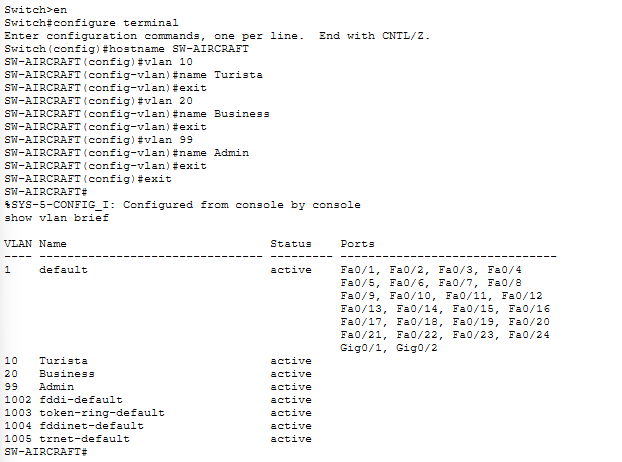

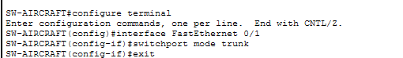

## ¿Qué es un enlace Trunk?
Un enlace troncal (trunk link) es un puerto o enlace físico de red configurado para transportar el tráfico de múltiples VLANs simultáneamente a través de un único cable.   A diferencia de un puerto de acceso (access port), que solo puede pertenecer a una única VLAN a la cual entrega tráfico no etiquetado, el enlace troncal utiliza un protocolo de etiquetado (como el estándar IEEE 802.1Q). Este protocolo inserta un encabezado especial en la trama Ethernet que contiene el identificador de la VLAN (VLAN ID), lo que permite al dispositivo receptor saber exactamente a qué red virtual pertenece cada paquete.

## Configuración de Enrutamiento, DHCP, NAT y Seguridad

En el router AIRCRAFT-R1 se aplicó enrutamiento Inter-VLAN Router-on-a-Stick creando las subinterfaces F0/0.10, F0/0.20 y F0/0.99 con encapsulación dot1Q e IPs de gateway. Se configuraron servidores DHCP para cada segmento excluyendo las primeras 10 direcciones. Se habilitó NAT con sobrecarga (PAT) en la interfaz FastEthernet0/1 mediante la lista de acceso 20, permitiendo salida a Internet únicamente a Business y Admin. Para Turista se aplicó la ACL extendida 100 en la subinterfaz F0/0.10, autorizando solo el tráfico hacia la subred del servidor local (10.10.99.0/24) y denegando la salida exterior.

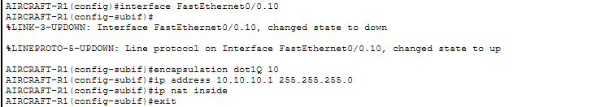

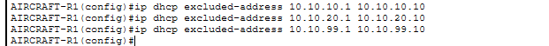

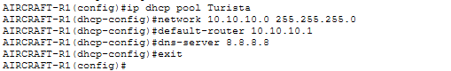

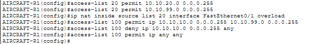

## ¿Qué es la encapsulación dot1Q
La encapsulación dot1Q hace referencia al estándar IEEE 802.1Q, un protocolo de Capa 2 (enlace de datos) utilizado para identificar y multiplexar el tráfico de múltiples VLANs a través de un único enlace troncal.
Cuando una trama Ethernet viaja por un enlace troncal, el protocolo 802.1Q le inserta una etiqueta (tag) de 4 bytes en la cabecera. Esta etiqueta contiene el VLAN ID (número identificador de la VLAN), lo que permite que los switches y routers sepan a qué red virtual pertenece cada paquete.

## Enrutamiento Inter-Vlan

- Un único cable físico (Troncal): Se conecta un solo cable entre un puerto del switch (configurado como enlace troncal o trunk) y una interfaz física del router (por ejemplo, FastEthernet0/0).
- Creación de Subinterfaces lógicas: La interfaz física del router se divide virtualmente en varias subinterfaces (por ejemplo, F0/0.10 para la VLAN 10 y F0/0.20 para la VLAN 20).
- Asignación de VLAN e IP (Gateway): A cada subinterface se le asigna el etiquetado del protocolo IEEE 802.1Q con su número de VLAN correspondiente y una dirección IP, la cual funciona como la puerta de enlace (default gateway) de esa VLAN.
- Flujo del tráfico: Cuando una PC de la VLAN 10 quiere enviar datos a una PC de la VLAN 20:

  El tráfico sale del switch hacia el router etiquetado con la VLAN 10 por el enlace troncal.
  
  El router recibe el paquete en la subinterface de la VLAN 10, lo enruta en Capa 3 hacia la subinterface de la VLAN 20, le cambia la etiqueta y lo devuelve al switch por el mismo cable físico.

## Configuración del Servidor de Entretenimiento e ISP

El servidor local se configuró con la IP estática 10.10.99.10 y el servicio HTTP activo con el portal AirConnect. En el ISP, la interfaz F0/0 se configuró con la IP 200.0.0.2/30 y la interfaz F0/1 con la IP 8.8.8.1/24 hacia un servidor público con IP 8.8.8.8 que simula la red pública de Internet.

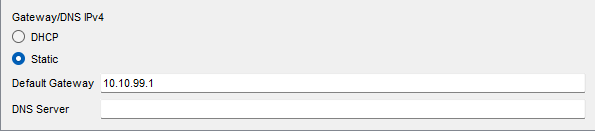

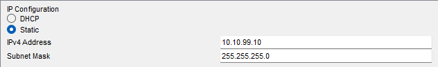

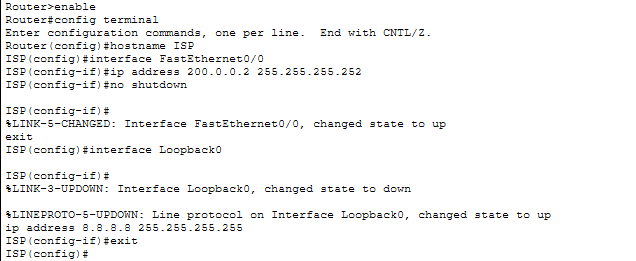

## Validaciones de Conectividad

Desde la PC Turista, el ping a 10.10.99.10 y el acceso web al servidor local funcionaron correctamente, mientras que el ping a 8.8.8.8 fue bloqueado por la ACL 100 (Destination host unreachable). Desde la PC Business, el acceso web local funcionó y el ping a 8.8.8.8 respondió con 100% de éxito. Desde la PC Admin se obtuvo conectividad total por ping hacia todas las subredes e Internet.

ipconfig de una de las Pc Turista.

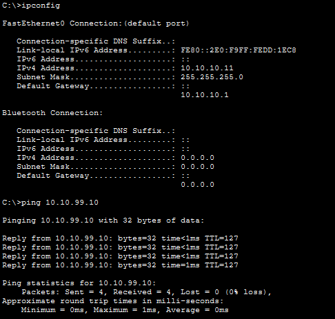

Prueba del servidor local desde Pc Turista.

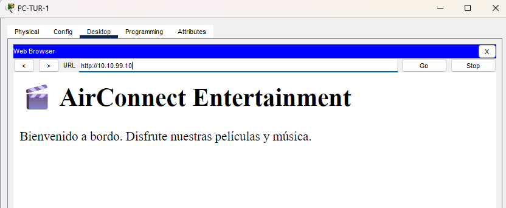

Ping a Internet desde Pc Turista

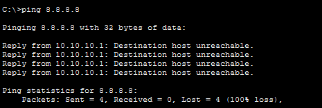

Prueba del servidor local desde Pc Business

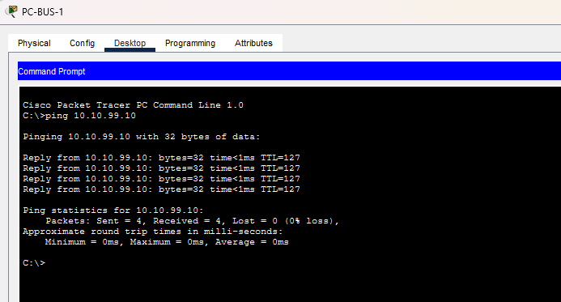

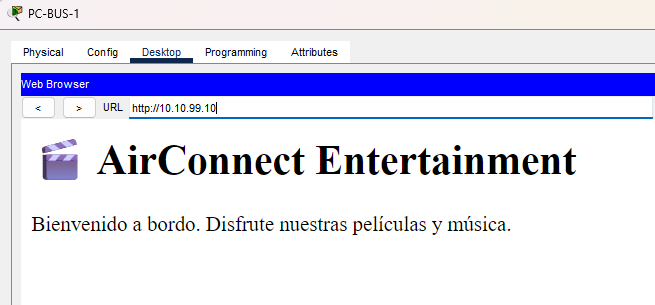

Ping a Internet desde Pc Business

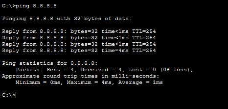

   

