# Laboratorio 5 - Comunicaciones de Datos

## 1.  a) ¿Qué es ICMP y para qué se usa? ¿Transporta datos de aplicaciones como lo hacen TCP o UDP?
ICMP (Internet Control Message Protocol) es un protocolo de control utilizado en redes IP para comunicar errores, informar condiciones de la red y realizar tareas de diagnóstico.
Entre sus principales funciones se encuentran:
- Notificar errores: por ejemplo, cuando un destino es inalcanzable.
- Realizar diagnósticos: mediante herramientas como ping, que permiten comprobar la conectividad entre dispositivos.
- Informar condiciones de la red: por ejemplo, cuando un paquete agota su tiempo de vida (TTL).
ICMP no está diseñado para transportar datos de aplicaciones como TCP o UDP. Su función principal es intercambiar mensajes de control y diagnóstico. Aunque puede incluir datos en sus mensajes, no proporciona un servicio general de transporte entre aplicaciones.

## 1. b) ¿Qué relación tiene con IP? ¿Viaja dentro de IP, al lado de IP o debajo de IP? ¿Cómo sabe el receptor que el contenido de un paquete IP es ICMP?
ICMP es un protocolo estrechamente relacionado con IP, ya que se utiliza para comunicar información sobre el funcionamiento de la red.
Los mensajes ICMP viajan encapsulados dentro de paquetes IP, es decir, forman parte de la carga útil (payload) del paquete IP.
La encapsulación es la siguiente:

<p align="center">
  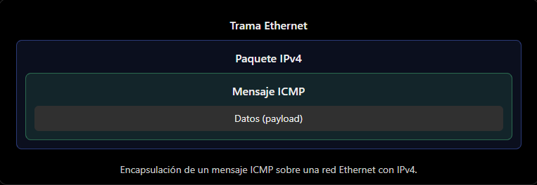
</p>

## 1. c) ¿Qué hace ping? ¿Qué son un Echo Request y un Echo Reply? ¿Qué campos de ICMP permiten distinguirlos?
ping es una herramienta de diagnóstico que permite comprobar si existe conectividad IP entre dos dispositivos de una red.
Para hacerlo, utiliza dos tipos de mensajes ICMP:
      -Echo Request (tipo 8): mensaje enviado por el dispositivo de origen para solicitar una respuesta.
      -Echo Reply (tipo 0): mensaje enviado por el dispositivo de destino en respuesta al Echo Request.

<p align="center">
  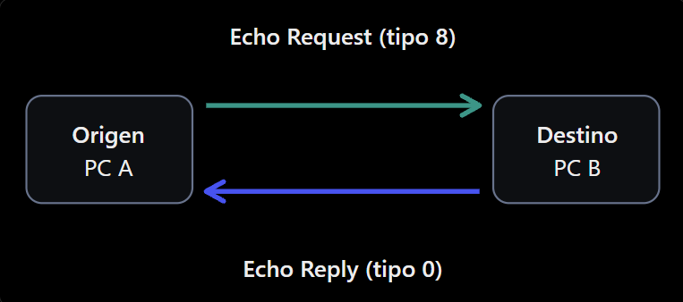
</p>

Los campos principales de ICMP que permiten distinguir ambos mensajes son:

| Campo | Echo Request | Echo Reply |
|  ---  |      ---     |     ---    |
|  Type |   8  | 0 |
|  Code |   0  | 0 |
| Identifier | identifica la solicitud | Se mantiene |
| Sequence Number | identifica el número de solicitud | Se mantiene |

El campo Type es el que permite distinguir directamente los dos mensajes.
Además, ping utiliza el tiempo transcurrido entre el envío del Request y la recepción del Reply para calcular el tiempo de ida y vuelta, denominado RTT (Round-Trip Time).

## 1. d) ¿Qué información mínima contiene un mensaje ICMP de tipo Echo?


| Campo | Tamaño | Función |
| --- | --- | --- |
| Type | 1 byte | Indica si es Request (8) o Reply (0). |
| Code | 1 byte | Para los mensajes Echo tiene valor 0. |
| Checksum | 2 bytes | Permite detectar errores en el mensaje ICMP. |
| Identifier | 2 bytes | Permite asociar las respuestas con sus solicitudes. |
| Sequence Number | 2 bytes | Permite identificar y ordenar las solicitudes enviadas. |

El encabezado ICMP Echo tiene un tamaño de 8 bytes.

El mensaje también puede contener un campo de datos o payload, de longitud variable, que normalmente utiliza ping para enviar información de prueba. El Echo Reply devuelve esos mismos datos.
Conclusión: ICMP es un protocolo de control y diagnóstico que funciona encapsulado en IP. La herramienta ping utiliza mensajes Echo Request y Echo Reply para verificar conectividad y medir tiempos de respuesta. Estos mensajes se identifican principalmente mediante el campo Type y contienen un encabezado mínimo de 8 bytes.


<p align="center">
  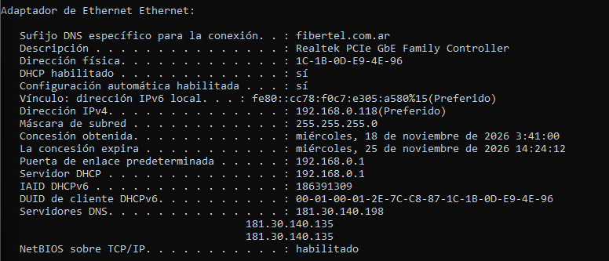
</p>

## ipconfig

<p align="center">
  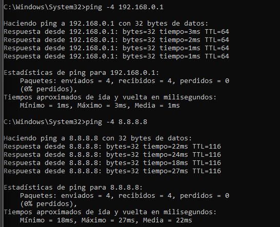
</p>

<p align="center">
  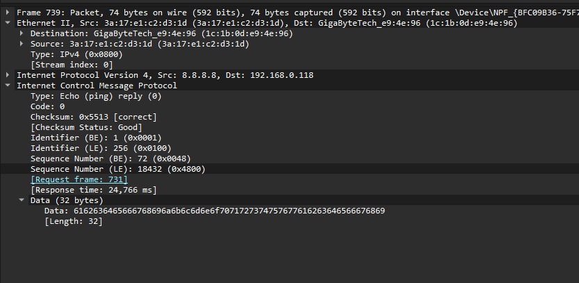
</p>

## Echo request y Wireshark


| Capa | Dirección/Identificador origen | Dirección/identificador destino | ¿Qué campo indica qué protocolo viene "adentro"? |
| :---: | :---: | :---: | :---: |
| Ethernet II | **1C:1B:0D:E9:4E:96** | **3A:17:E1:C2:D3:1D** | **0x0800 (IPv4)** |
| Internet Protocol Version 4 | **192.168.0.118** | **8.8.8.8** | **1 (ICMP)** |
| Internet Control Message Protocol | **Identifier = 0x0001, Sequence = 71** | **No tiene dirección de destino propia.** | **Type = 8, Code = 0** |
| Datos / payload | **No tiene origen propio.** | **No tiene origen propio.** | **No hay otro protocolo; son datos del ping.** |

## a)	Dirección MAC destino del Echo Request
La dirección MAC destino del Echo Request enviado a 8.8.8.8 no corresponde al servidor de Google, sino a la interfaz del gateway de nuestra red local, cuya dirección IP es 192.168.0.1.
Las direcciones MAC permiten identificar interfaces dentro de un enlace de red local, mientras que las direcciones IP permiten identificar el origen y el destino de los paquetes a través de múltiples redes. Las direcciones MAC pueden cambiar en cada salto del recorrido, mientras que las direcciones IP de origen y destino normalmente se mantienen.

## b)	Request y Reply. Entre los paquetes 731 (request) y 739 (reply) se invierten las MAC de origen y destino, y también las IP (192.168.0.118 ↔ 8.8.8.8).
La MAC de origen del Reply es la del gateway, porque es el equipo que nos entrega esa trama en nuestra red. En ICMP, el campo Type cambia de 8 (Echo Request) a 0 (Echo Reply), mientras que el identificador y el número de secuencia permanecen iguales.
El identificador y el número de secuencia se mantienen porque permiten relacionar cada Echo Reply con el Echo Request que lo originó, incluso cuando se realizan múltiples solicitudes consecutivas.

## c)	El payload de ping se encuentra dentro del mensaje ICMP, después de su encabezado de 8 bytes. En nuestra captura de Wireshark, específicamente en el paquete 739 (Echo Reply), se observa un payload de 32 bytes, que contiene la siguiente secuencia de caracteres ASCII: abcdefghijklmnopqrstuvwabcdefghi.
El Echo Reply devuelve los mismos datos enviados en el Echo Request, permitiendo comprobar que la información recibida coincide con la enviada. En nuestro caso, el paquete 739 corresponde a la respuesta del paquete 731.
El contenido del payload puede variar según el sistema operativo y la implementación de ping. Por ejemplo, Windows utiliza normalmente 32 bytes de datos, mientras que Linux suele utilizar 56 bytes por defecto. Esto demuestra que ICMP no establece un contenido fijo para los datos del mensaje Echo, por lo que cada implementación puede utilizar distintos tamaños y patrones.

## d)	La diferencia entre ambos TTL se debe a que los dispositivos pueden utilizar distintos valores iniciales y a que los routers disminuyen el TTL durante el recorrido.
Por lo tanto, el TTL recibido depende tanto de su valor inicial como de la cantidad de saltos realizados.

## e) Trama Ethernet: 74 bytes
        └── Cabecera Ethernet II: 14 bytes
            └── Paquete IPv4: 60 bytes
                ├── Cabecera IPv4: 20 bytes
                └── Mensaje ICMP: 40 bytes
                    ├── Cabecera Echo Request: 8 bytes
                    └── Datos del ping: 32 bytes

## 2. a)  ¿Qué problema resuelve ARP? ¿En qué capa lo ubicarían y por qué es discutible?
ARP (Address Resolution Protocol) es un protocolo que permite obtener la dirección MAC asociada a una dirección IPv4 dentro de una red local.
Su función principal es resolver el problema de cómo enviar una trama Ethernet cuando se conoce la dirección IP del siguiente dispositivo, pero se desconoce su dirección MAC.
ARP suele ubicarse en la capa de enlace de datos (capa 2 del modelo OSI), ya que sus mensajes se transportan directamente en tramas Ethernet, sin utilizar un encabezado IP.
Sin embargo, su clasificación es discutible porque relaciona direcciones de dos capas diferentes: las direcciones IP de la capa de red (capa 3) y las direcciones MAC de la capa de enlace (capa 2). Por este motivo, también se considera un protocolo que funciona entre ambas capas.

## 2. b) ¿Qué es un ARP Request y un ARP Reply? ¿A quién se envía cada uno?
ARP utiliza dos tipos principales de mensajes para resolver direcciones:
- ARP Request: es una solicitud que envía un dispositivo cuando necesita conocer la dirección MAC asociada a una dirección IPv4. Generalmente se envía mediante broadcast, utilizando la dirección MAC FF:FF:FF:FF:FF:FF, para que todos los dispositivos del segmento local puedan recibirla.
- ARP Reply: es la respuesta enviada por el dispositivo que posee la dirección IP solicitada. Contiene su dirección MAC y normalmente se envía mediante unicast, directamente al dispositivo que realizó la solicitud.
Por ejemplo, si nuestra computadora (192.168.0.118) necesita conocer la MAC del gateway (192.168.0.1), el intercambio sería:

```text
PC (192.168.0.118)
|
├── ARP Request (Broadcast)
|   "¿Quién tiene 192.168.0.1?"

|               |
|               ▼
|            Gateway
|          192.168.0.1

|               |
└── ARP Reply (Unicast)
    "192.168.0.1 tiene la MAC
     3A:17:E1:C2:D3:1D"
```
La dirección MAC indicada es la que observamos como destino en tu captura ICMP anterior; todavía debemos confirmar su asociación con el gateway mediante la caché ARP.

## 2. c)¿Qué es la caché ARP y por qué existe?
La caché ARP es una tabla que mantiene el sistema operativo y que almacena temporalmente las asociaciones entre direcciones IPv4 y direcciones MAC de los dispositivos de la red local.

Su objetivo es evitar que la computadora tenga que realizar una nueva solicitud ARP cada vez que necesita comunicarse con un dispositivo cuya dirección MAC ya conoce.

Esto permite reducir el tráfico broadcast y mejorar la eficiencia de la comunicación.

Las entradas de la caché ARP pueden actualizarse o eliminarse después de cierto tiempo, evitando mantener indefinidamente asociaciones que podrían dejar de ser válidas.

## 2. d) Tengo la IP de una máquina de mi red local. ¿Cómo sé a qué dirección MAC debo enviarle la trama?
Primero, la computadora consulta su caché ARP para verificar si ya conoce la dirección MAC asociada a la IP de destino.
Si encuentra una entrada válida, utiliza directamente esa dirección MAC para construir la trama Ethernet.
Si no encuentra la dirección MAC, envía un ARP Request mediante broadcast preguntando qué dispositivo tiene la IP buscada.
El dispositivo que reconoce esa dirección IP responde con un ARP Reply, indicando su dirección MAC. La computadora almacena esta asociación en su caché ARP y utiliza la MAC obtenida para enviar la trama Ethernet.
Este procedimiento permite transformar una dirección IPv4 conocida en la dirección MAC necesaria para comunicarse dentro de la red local.

## 2. e) Ver la caché ARP de su computadora y buscar la entrada del gateway:

<p align="center">
  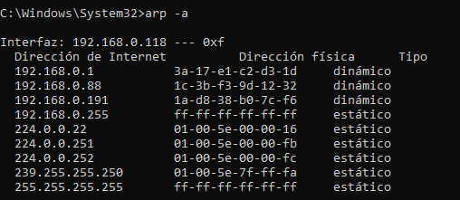
</p>

Sí, la dirección MAC asociada al gateway coincide con la dirección MAC destino observada anteriormente en Wireshark.

## 2. f) Generar tráfico ARP y capturarlo

Utilizando el método A con una ip sin uso:

<p align="center">
  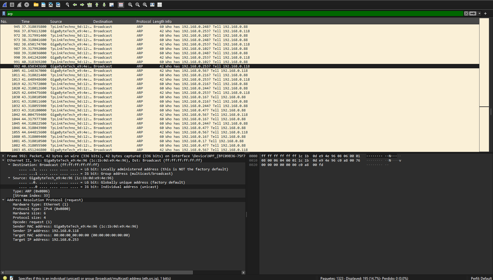
</p>

Del paquete 992 podemos completar toda la columna correspondiente al ARP Request.

| Campo | ARP Request (paquete 992) | ARP Reply |
| --- | --- | --- |
| MAC destino (Ethernet) | `FF:FF:FF:FF:FF:FF` | Pendiente |
| MAC origen (Ethernet) | `1C:1B:0D:E9:4E:96` | Pendiente |
| Opcode | `1` (Request) | `2` (Reply) |
| Sender MAC address | `1C:1B:0D:E9:4E:96` | Pendiente |
| Sender IP address | `192.168.0.118` | Pendiente |
| Target MAC address | `00:00:00:00:00:00` | Pendiente |
| Target IP address | `192.168.0.253` | Pendiente |

Haciendo ping a la dirección IP de mi celular:

<p align="center">
  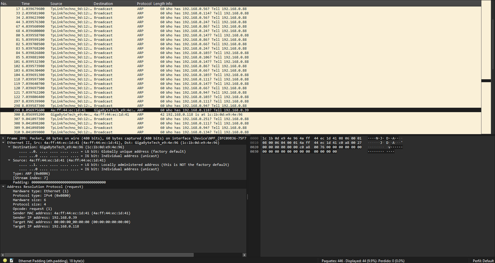
</p>


| Campo | ARP Request (299) | ARP Reply (300) |
| --- | --- | --- |
| MAC destino (encabezado Ethernet) | `FF:FF:FF:FF:FF:FF` | `4A:FF:44:EC:1D:41` |
| MAC origen (encabezado Ethernet) | `4A:FF:44:EC:1D:41` | `1C:1B:0D:E9:4E:96` |
| Opcode | `1` (Request) | `2` (Reply) |
| Sender MAC address | `4A:FF:44:EC:1D:41` | `1C:1B:0D:E9:4E:96` |
| Sender IP address | `192.168.0.39` | `192.168.0.118` |
| Target MAC address | `00:00:00:00:00:00` | `4A:FF:44:EC:1D:41` |
| Target IP address | `192.168.0.118` | `192.168.0.39` |

En este caso, el celular (192.168.0.39) consultó la dirección MAC de la computadora (192.168.0.118), y la computadora respondió. Aunque se generó el tráfico haciendo ping al celular, los dos paquetes seleccionados corresponden a una consulta ARP iniciada por el celular.

## ¿Por qué el Request va a una dirección broadcast y el Reply no? ¿Qué valor tiene Target MAC address en el Request y por qué?

El ARP Request se envía a una dirección broadcast (FF:FF:FF:FF:FF:FF) porque el dispositivo emisor desconoce la dirección MAC asociada a la dirección IP que desea consultar. De esta manera, todos los dispositivos del segmento de red local reciben la solicitud y aquel que posee la IP buscada puede responder.
En cambio, el ARP Reply se envía mediante unicast, directamente al dispositivo que realizó la solicitud, ya que su dirección MAC se encuentra incluida en el ARP Request.
En nuestra captura, el paquete 299 corresponde al ARP Request enviado por el celular (192.168.0.39) y el paquete 300 al ARP Reply enviado por nuestra computadora (192.168.0.118).
El campo Target MAC address del ARP Request tiene el valor 00:00:00:00:00:00, porque representa precisamente la dirección MAC que se intenta descubrir.

## En el encabezado Ethernet de la trama ARP, ¿qué valor tiene el campo Type? ¿Hay un encabezado IP? ¿Qué les dice eso sobre dónde "vive" ARP? 

En el encabezado Ethernet de los paquetes ARP, el campo Type (EtherType) tiene el valor 0x0806, que identifica al protocolo ARP.
En la captura de Wireshark se observa que, después del encabezado Ethernet II, aparece directamente el encabezado Address Resolution Protocol, sin un encabezado IP intermedio.
Esto demuestra que ARP se transporta directamente sobre Ethernet y funciona en la capa de enlace de datos (capa 2 del modelo OSI).
Sin embargo, su clasificación es discutible porque permite relacionar las direcciones IPv4 de la capa de red con las direcciones MAC de la capa de enlace, actuando como un mecanismo de comunicación entre ambas capas.

## Con la Opción A (IP inexistente): ¿cuántos ARP Request aparecieron? ¿Hubo Reply? ¿Apareció algún ICMP Echo Request en la captura? Expliquen por qué. 

Al realizar un ping hacia la dirección 192.168.0.253, perteneciente a nuestra subred local pero aparentemente sin ningún dispositivo asociado, se observaron varias solicitudes ARP Request.
En la captura proporcionada se identifican al menos tres solicitudes dirigidas a esa dirección IP, correspondientes a los paquetes 966, 982 y 992, además de otras solicitudes posteriores.
No se observó ningún ARP Reply asociado a esa dirección en los paquetes mostrados, ya que aparentemente ningún dispositivo de la red posee dicha IP.
Por este motivo, la computadora no pudo resolver la dirección MAC del destino y, en consecuencia, no pudo construir la trama Ethernet necesaria para enviar el ICMP Echo Request.

## Volvieron a hacer ping al mismo destino un minuto después: ¿apareció ARP de nuevo? Revisen la caché ARP. ¿Qué ventaja tiene la caché y qué problema podría causar si una entrada quedara vieja?

<p align="center">
  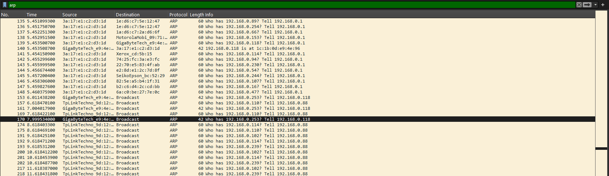
</p>

Al repetir el ping hacia la dirección 192.168.0.253, se observó que la computadora volvió a generar solicitudes ARP. En la nueva captura de Wireshark se identificaron tres ARP Request, correspondientes a los paquetes 153, 161 y 170, sin recibir una respuesta ARP del destino.
Esto ocurre porque la dirección IP consultada aparentemente no corresponde a ningún dispositivo activo de la red local. Como no se obtuvo una dirección MAC válida, el sistema operativo debe intentar resolverla nuevamente cuando necesita comunicarse con ese destino.
La caché ARP permite almacenar temporalmente las asociaciones entre direcciones IP y MAC, evitando realizar nuevas solicitudes ARP cada vez que se establece comunicación con un dispositivo conocido. Esto reduce el tráfico broadcast y mejora la eficiencia de la red.

Al consultar la caché ARP, se comprobó que la dirección 192.168.0.253 no tenía una asociación MAC válida almacenada, lo que explica la necesidad de repetir las solicitudes ARP.

## 3. a) ¿Qué significa "establecer una conexión"? ¿Dónde "existe" una conexión TCP: en los cables, en los routers o en los extremos? 

<p align="center">
  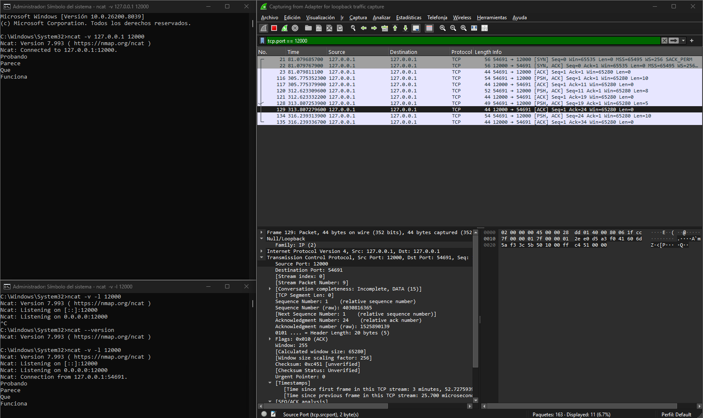
</p>

<p align="center">
  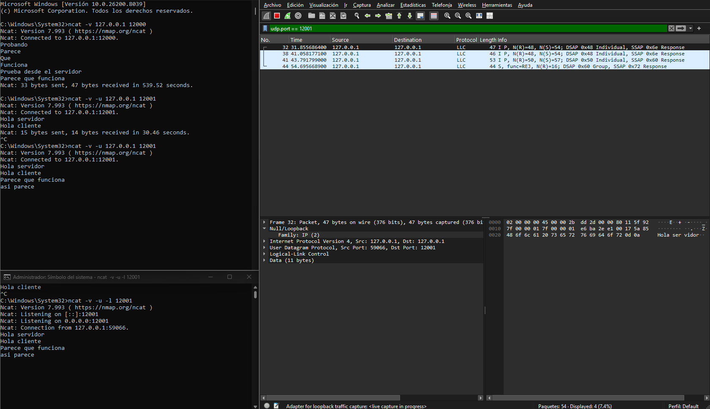
</p>

Establecer una conexión TCP significa iniciar una comunicación lógica entre dos dispositivos, acordando los parámetros necesarios para intercambiar datos de manera confiable y ordenada.
Este proceso se realiza mediante el mecanismo conocido como three-way handshake, que consiste en el intercambio de tres segmentos:
La conexión TCP existe lógicamente en los extremos de la comunicación, es decir, en los sistemas operativos del cliente y del servidor, que mantienen información sobre su estado.
Los cables solamente transmiten señales y los routers encaminan paquetes IP, pero normalmente no mantienen el estado de cada conexión TCP.

## 3. b)  ¿Qué es un puerto? ¿Qué identifica el par (IP, puerto)? 
Un puerto es un identificador numérico de 16 bits utilizado por protocolos de transporte como TCP y UDP para distinguir servicios y aplicaciones que se comunican a través de la red.
El par (dirección IP, puerto) identifica un extremo de comunicación dentro de un protocolo de transporte.
- La dirección IP identifica la interfaz o dirección de red del dispositivo.
- El puerto identifica el punto de comunicación asociado a un proceso o servicio.
Por ejemplo, en nuestro laboratorio utilizaremos:

  Dirección IP: 127.0.0.1
  Puerto TCP:   12000

Este par identifica el extremo donde estará escuchando nuestro servidor TCP.
Una conexión TCP completa se distingue mediante las IP y puertos de ambos extremos, junto con el protocolo TCP.

## 3. c) ¿Qué significa que un proceso esté "escuchando" en un puerto? 
Que un proceso esté escuchando en un puerto significa que ha creado un socket, lo ha asociado a una dirección IP y un puerto, y se encuentra preparado para aceptar solicitudes de conexión entrantes.
En TCP, el sistema operativo mantiene ese socket en estado LISTEN y puede responder a las solicitudes de conexión de los clientes.
En nuestro experimento, ejecutaremos:

ncat -v -l 12000

Este comando inicia un servidor que escucha conexiones TCP en el puerto 12000.
Cuando un cliente intenta conectarse a ese puerto, el servidor puede aceptar la conexión y comenzar a intercambiar datos.

## ¿Qué pasó en la red cuando ejecutaron el comando del cliente, antes de escribir el primer mensaje? Compárenlo con TCP.
Al ejecutar el cliente UDP, antes de escribir el primer mensaje, no se observó ningún intercambio de paquetes destinado a establecer una conexión. Esto se debe a que UDP es un protocolo no orientado a conexión y no necesita realizar un procedimiento de establecimiento previo a la transmisión de datos.
En cambio, al ejecutar el cliente TCP, Wireshark registró tres segmentos correspondientes al three-way handshake: SYN (paquete 21), SYN-ACK (paquete 22) y ACK (paquete 23).
Por lo tanto, TCP establece una conexión antes de intercambiar datos, mientras que UDP puede comenzar a transmitir datagramas directamente.

## ¿Cuántos datagramas generó cada mensaje? ¿Hay algo parecido a un ACK?
En nuestro experimento UDP se observaron cuatro datagramas, correspondientes a los cuatro mensajes intercambiados entre el cliente y el servidor.

| Paquete | Longitud capturada | Contenido |
| :--- | ---: | :--- |
| 32 | 47 bytes | Hola servidor |
| 38 | 46 bytes | Mensaje de respuesta |
| 41 | 53 bytes | Mensaje adicional |
| 44 | 44 bytes | Mensaje adicional |

A diferencia de TCP, UDP no utiliza confirmaciones ACK para garantizar que los datos fueron recibidos. Por este motivo, no se observaron paquetes adicionales de reconocimiento por cada mensaje enviado.
Esto implica que UDP no garantiza por sí mismo la entrega, el orden ni la retransmisión de los datos perdidos.

## Comparen el encabezado UDP con el encabezado TCP de un segmento con datos: ¿qué campos tiene cada uno? ¿Cuántos bytes ocupa cada encabezado?

El encabezado UDP es más simple que el de TCP, ya que contiene únicamente cuatro campos y tiene un tamaño fijo de 8 bytes.
En cambio, TCP incorpora información adicional que permite controlar las conexiones, ordenar los datos, confirmar su recepción y regular la transmisión.


| Campo | TCP | UDP |
| --- | --- | --- |
| Puerto origen | Sí | Sí |
| Puerto destino | Sí | Sí |
| Número de secuencia | Sí | No |
| Número de reconocimiento | Sí | No |
| Longitud del encabezado | Sí | No |
| Flags de control | Sí | No |
| Tamaño de ventana | Sí | No |
| Checksum | Sí | Sí |
| Puntero urgente | Sí | No |
| Longitud del datagrama | No como campo específico | Sí |
| Opciones | Opcional | No |

En cuanto a sus tamaños:
- UDP: encabezado fijo de 8 bytes.
- TCP: encabezado mínimo de 20 bytes, que puede aumentar hasta 60 bytes cuando se incluyen opciones.
En nuestras capturas, los segmentos TCP que transportaban mensajes tenían encabezados de 20 bytes, mientras que los datagramas UDP tenían encabezados de 8 bytes.
Esta diferencia refleja que TCP proporciona mecanismos de control adicionales que UDP no implementa.

## ¿Qué pasó en la red al cerrar el cliente con Ctrl+C? ¿Y en TCP?
Al cerrar el cliente UDP mediante Ctrl+C, no se observó un intercambio específico de paquetes destinado a finalizar la comunicación, ya que UDP no mantiene una conexión establecida entre los extremos.
En cambio, al cerrar la comunicación TCP, Wireshark registró un intercambio de segmentos FIN y ACK para finalizar la conexión de forma ordenada.
En nuestra captura TCP se identificaron los siguientes paquetes:


| Paquete | Flags | Función |
| --- | --- | --- |
| 312 | FIN, ACK | El servidor inicia el cierre. |
| 313 | ACK | El cliente confirma el cierre del servidor. |
| 315 | FIN, ACK | El cliente cierra su extremo. |
| 316 | ACK | El servidor confirma el cierre del cliente. |

## Para enviar la misma frase, ¿cuántos paquetes necesitaron en total con TCP y cuántos con UDP? ¿Qué «compran» con los paquetes extra de TCP?

En las capturas realizadas con Wireshark se observaron diferencias en la cantidad de paquetes necesarios para transmitir datos.
Para enviar una frase, UDP utilizó un único datagrama, mientras que TCP requirió establecer previamente una conexión y confirmar la recepción de los datos.
En nuestro experimento, los paquetes capturados fueron:


| Etapa | TCP | UDP |
| :--- | ---: | ---: |
| Establecimiento de conexión | 3 | 0 |
| Transferencia de datos | 12 | 4 |
| Cierre de conexión | 4 | 0 |
| **Total del experimento** | **19** | **4** |

Estos valores corresponden a los intercambios completos observados, no al envío de una única frase. En TCP se enviaron seis mensajes de aplicación y en UDP cuatro.
Si consideramos una conexión nueva para enviar una sola frase, TCP podría necesitar, en un caso sencillo, 3 segmentos para establecer la conexión, 1 para transmitir los datos, 1 ACK de confirmación y 4 para cerrar la conexión: 9 segmentos en total. UDP podría enviar esa misma frase en un único datagrama. La cantidad real de segmentos TCP puede variar.
Los paquetes adicionales de TCP permiten proporcionar mecanismos de entrega confiable, ordenamiento, detección de pérdidas, retransmisión y control de flujo y congestión, funcionalidades que UDP no ofrece directamente.

## 4. Servidor TCP mínimo - TP5 Redes de Computadoras. 

<p align="center">
  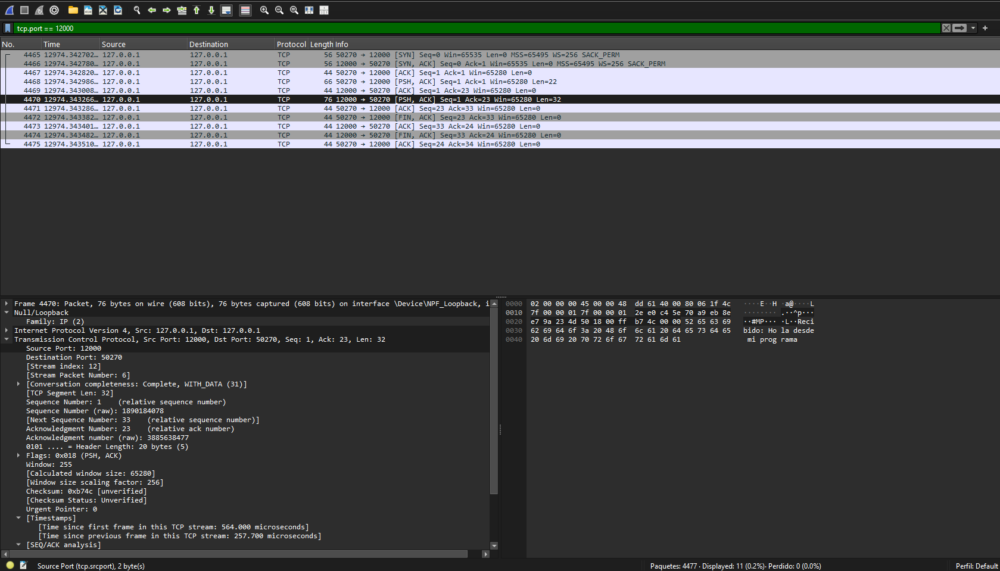
</p>

- socket(), bind() y listen(): son operaciones locales del sistema operativo y no producen tráfico de red.
- connect(): inicia el establecimiento de la conexión TCP mediante el three-way handshake.
- accept(): espera una conexión entrante y devuelve un socket conectado. No genera tráfico por sí misma.
- sendall(): envía los datos de la aplicación. En nuestra captura, el cliente envió 22 bytes y el servidor respondió con 32 bytes.
- recv(): obtiene datos recibidos por el socket. Los ACK observados son generados por el protocolo TCP, no directamente por esta función.
- close(): inicia el cierre del socket. En nuestra captura se observan los intercambios FIN-ACK y ACK de ambos extremos.


| Llamada | ¿Dónde se ejecuta? | ¿Genera tráfico? | Segmentos que observan |
| --- | --- | --- | --- |
| `socket()` | Servidor y cliente | No | Ninguno. |
| `bind()` | Servidor | No | Ninguno. |
| `listen()` | Servidor | No | Ninguno. |
| `connect()` | Cliente | Sí | 4465 `[SYN]`, 4466 `[SYN, ACK]`, 4467 `[ACK]`. |
| `accept()` | Servidor | No directamente | Retorna después del establecimiento de la conexión (4465–4467). |
| `sendall()` | Servidor y cliente | Sí | 4468 `[PSH, ACK]` (cliente) y 4470 `[PSH, ACK]` (servidor). |
| `recv()` | Servidor y cliente | No directamente | 4469 `[ACK]` (servidor) y 4471 `[ACK]` (cliente), generados automáticamente por TCP. |
| `close()` | Ambos | Sí | 4472 `[FIN, ACK]`, 4473 `[ACK]`, 4474 `[FIN, ACK]`, 4475 `[ACK]`. |


## Conclusión

A lo largo de este trabajo práctico se logró comprender y analizar el funcionamiento de distintos protocolos de comunicación de redes, relacionando los conceptos teóricos con su comportamiento real mediante el uso de Wireshark, Ncat y Python.
En primer lugar, mediante el protocolo ICMP, se estudió el funcionamiento de la herramienta ping, identificando los mensajes Echo Request y Echo Reply, sus encabezados, direcciones de origen y destino, valores de TTL y el proceso de encapsulación de los datos. Posteriormente, con ARP, se observó cómo los dispositivos de una red local obtienen las direcciones MAC asociadas a determinadas direcciones IP, analizando el intercambio de solicitudes y respuestas, así como la utilidad de la caché ARP.
Luego, mediante Ncat, se experimentó con los protocolos de transporte TCP y UDP, identificando sus principales diferencias. Se comprobó que TCP establece una conexión mediante el three-way handshake, utiliza mecanismos de confirmación de recepción y permite un cierre ordenado, mientras que UDP transmite datagramas sin necesidad de establecer una conexión previa ni confirmar su recepción.
Finalmente, se implementó una comunicación cliente-servidor mediante sockets TCP en Python, lo que permitió relacionar las funciones utilizadas en el código con los segmentos capturados en Wireshark, comprendiendo cómo las aplicaciones interactúan con los protocolos de red.
En conclusión, el laboratorio permitió integrar los conocimientos sobre direccionamiento, encapsulación, resolución de direcciones y protocolos de transporte, observando cómo interactúan las distintas capas de comunicación. Además, se adquirió experiencia práctica en el análisis de tráfico de red y en la implementación de comunicaciones mediante sockets, reforzando la comprensión del funcionamiento de las redes de computadoras.
