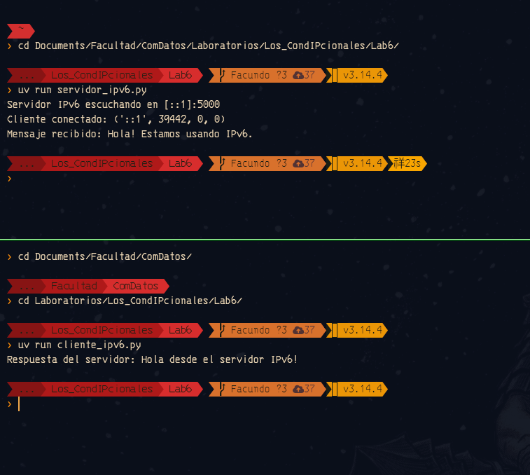
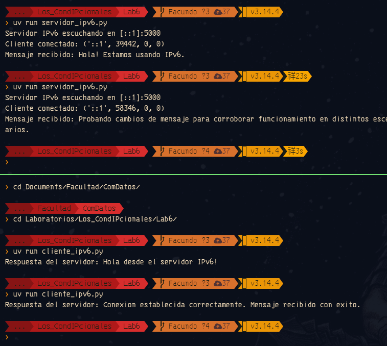
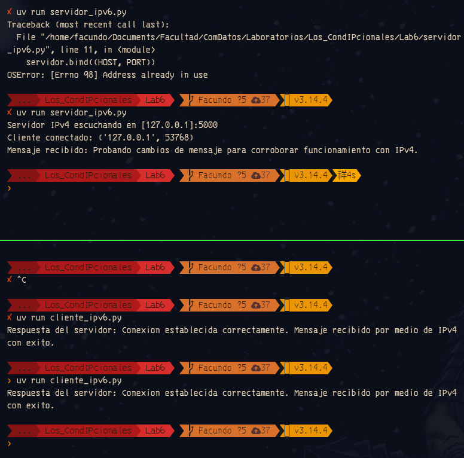
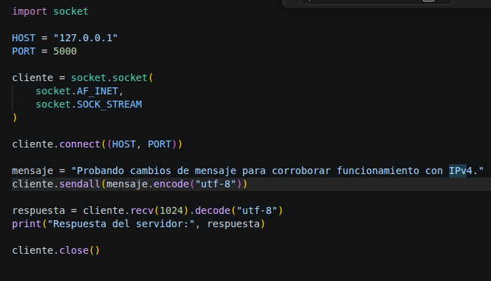
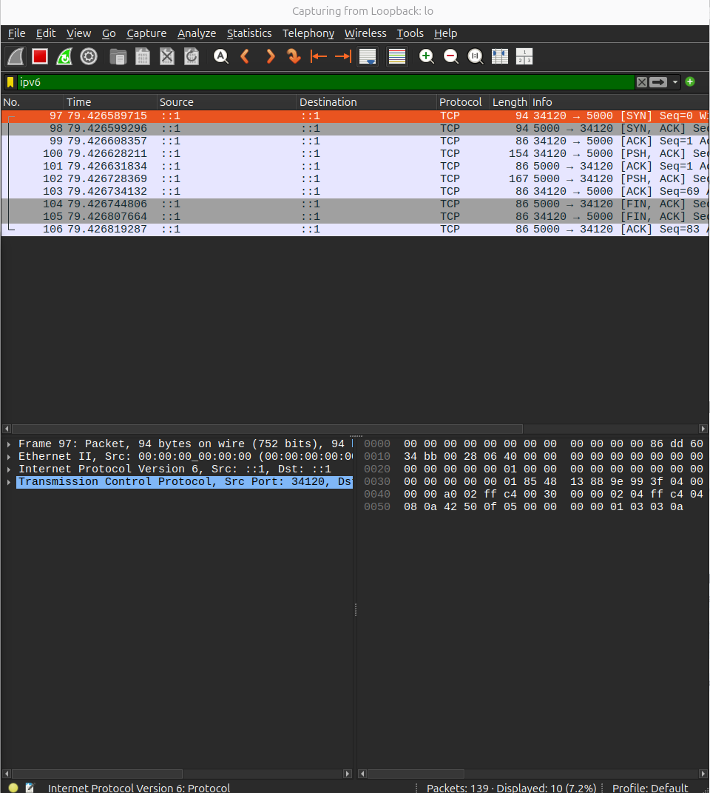
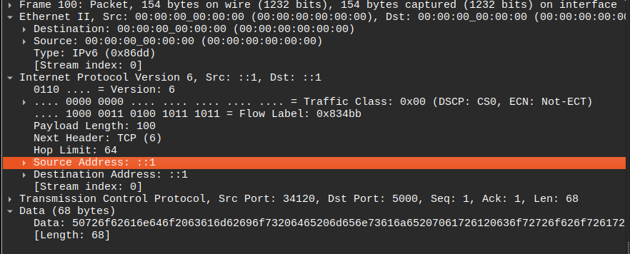
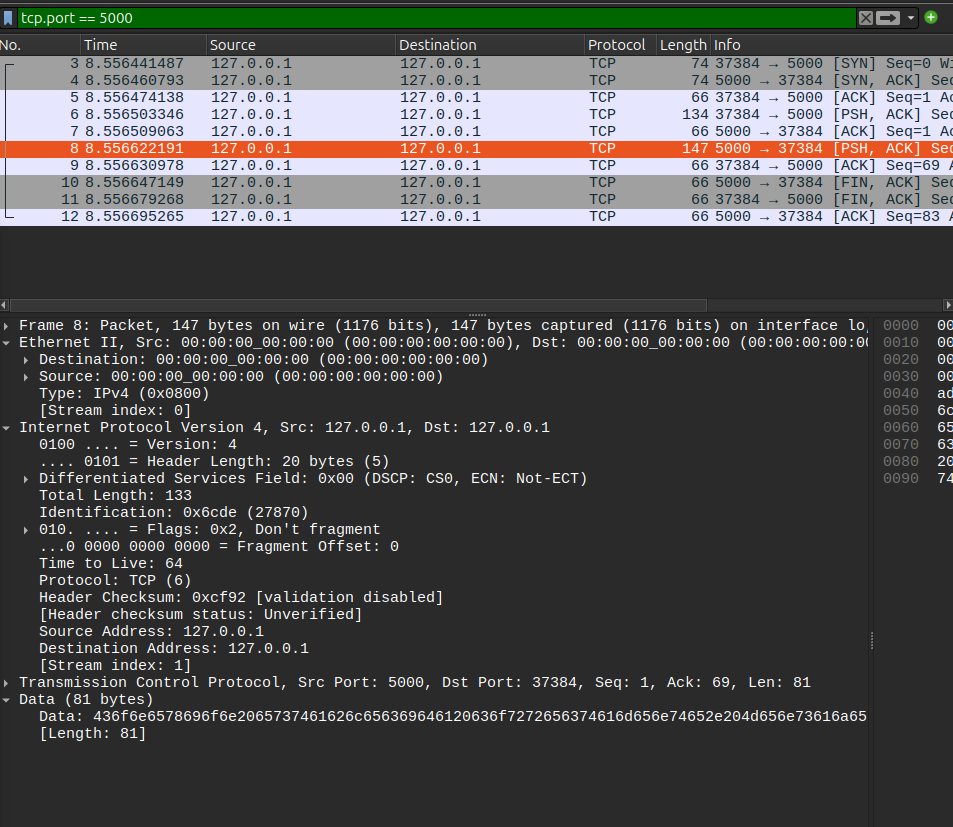
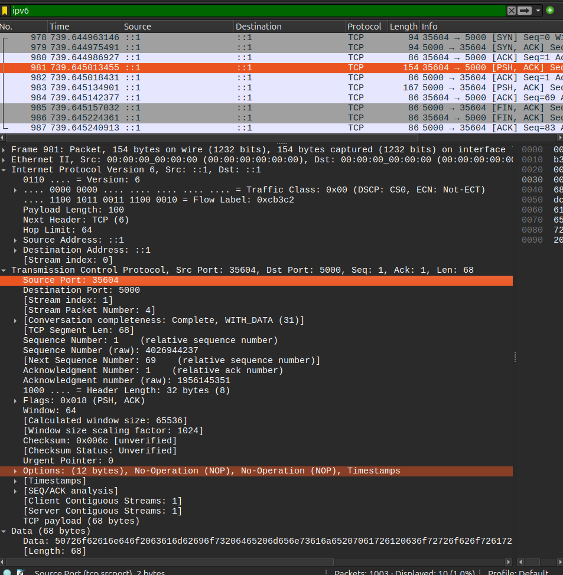

# Trabajo Práctico N° 6 - Comunicaciones de Datos

## Actividad 1. Conociendo IPv6

En esta sección se procede a realizar una investigación respecto al protocolo de capa de red **IPv6**. En base a esto, se contestan las preguntas propuestas en la consigna de trabajo:

### 1. ¿Cuántos bits tiene una dirección IPv4 y cuántos una IPv6? ¿Por qué fue necesario desarrollar IPv6?

Para **IPv4** se utiliza un conjunto de 4 bytes, es decir, **32 bits**, representados por números decimales separados por puntos. Mientras tanto, **IPv6** se representa mediante 8 grupos (hextetos) de 4 dígitos hexadecimales cada uno, donde cada valor hexadecimal equivale a 4 bits, dándonos un total de **128 bits** de dirección.

IPv4 tiene la capacidad teórica de representar alrededor de 4.300 millones de direcciones ($2^{32}$), pero en la práctica la disponibilidad es menor dado que varios rangos están reservados para usos específicos. Con el pasar de los años se produjo un gran aumento en la cantidad de dispositivos conectados a las redes, haciendo que el espacio de direcciones de IPv4 comenzara a agotarse. Por este motivo fue introducido IPv6 como su sucesor, expandiendo el rango de direcciones a aproximadamente **340 sextillones** ($3,4 \times 10^{38}$, o 340 undecillones en escala corta).

---

### 2. Investigar y responder: suponiendo que tenemos Internet universal, ¿podríamos asignar una IPv6 única a cada estrella del universo observable?

Si tomamos como referencia la estimación del siguiente artículo de la NASA:
* [What Is the Universe? - NASA Science](https://science.nasa.gov/exoplanets/what-is-the-universe/)

Allí se estima que el universo observable contiene alrededor de $10^{22}$ estrellas. Teniendo en cuenta que IPv6 permite asignar cerca de $340 \times 10^{36}$ ($3,4 \times 10^{38}$) direcciones, **sí podríamos asignar una dirección IPv6 única a cada estrella del universo observable** (y sobrarían órdenes de magnitud).

---

### 3. ¿Qué diferencia existe entre las direcciones unicast, multicast y anycast? ¿IPv6 utiliza broadcast?

* **Unicast:** Identifican a una única interfaz. Dentro de ellas podemos destacar:
  * **Unicast Globales (GUA):** Equivalentes a las direcciones públicas de IPv4. Utilizan el rango `2000::/3` y deben estar registradas para ser enrutadas en Internet. Típicamente, los primeros 48 bits representan el prefijo de red global, los siguientes 16 bits el ID de subred y los últimos 64 bits el ID de interfaz.
  * **Locales de Enlace (*Link-Local* / LLA):** Se generan automáticamente en interfaces con IPv6 habilitado (`ipv6 enable`) o manualmente mediante `ipv6 address`. Utilizan el bloque `fe80::/10` y sirven exclusivamente para la comunicación dentro de una misma subred o enlace local.
* **Multicast:** Identifican a un grupo de interfaces; un paquete enviado a una dirección multicast se entrega a todos los miembros del grupo. Utilizan el bloque `ff00::/8`, dentro del cual existen direcciones reservadas para distintos niveles de alcance y grupos de nodos.
* **Anycast:** Se asigna la misma dirección unicast a las interfaces de varios dispositivos. Al establecer comunicación con una dirección Anycast, el paquete es enrutado únicamente hacia el **nodo más cercano** (según la métrica de enrutamiento) que posea dicha dirección; en caso de no estar disponible, se encamina hacia el siguiente.

**¿IPv6 utiliza broadcast?**  
En IPv6 **no se utiliza broadcast**, por lo que no existen direcciones de difusión general. En su lugar, se emplea **multicast** (por ejemplo, utilizando la dirección `ff02::1` para enviar mensajes a todos los nodos de un enlace local).

---

### 4. ¿Qué es una dirección link-local? ¿Por qué normalmente comienzan con `fe80::`? ¿Podemos utilizar estas direcciones para comunicar dos computadoras conectadas al mismo switch?

Las direcciones **link-local (LLA)** son direcciones de alcance local generadas automáticamente en las interfaces con IPv6 activo (o configuradas manualmente). Utilizan el bloque reservado `fe80::/10` (cuyo primer hexteto abarca desde `fe80` hasta `febf`, aunque por estándar los 54 bits siguientes al prefijo se completan con ceros, por lo que normalmente comienzan con `fe80::`).

Este rango fue reservado y estandarizado para cursar tráfico únicamente dentro del mismo segmento de red local (enlace), ya que **los routers nunca reenvían paquetes con direcciones de origen o destino link-local**. Por lo tanto, **sí podemos utilizar estas direcciones para comunicar dos computadoras conectadas al mismo switch**, siempre y cuando la comunicación sea directa en el mismo enlace y no deba atravesar un router.

---

### 5. ¿Qué significan los siguientes prefijos en IPv6?

* **a. `/64`:** Indica que los primeros 64 bits corresponden al prefijo de red (típicamente 48 bits de prefijo global y 16 bits de subred en direcciones GUA) y los 64 bits restantes se destinan al identificador de interfaz del dispositivo. Es el tamaño de prefijo estándar para subredes locales (LAN).
* **b. `/24`:** Indica que solo los primeros 24 bits identifican al prefijo de red, dejando 104 bits disponibles para subredes y hosts. Suele utilizarse únicamente para bloques de direccionamiento masivos o internacionales (asignaciones de IANA a registros regionales o grandes proveedores de Internet).

---

### 6. Simplificar las siguientes direcciones IPv6:

* **a)** `2001:0db8:0000:0000:0000:0000:0000:0001` $\rightarrow$ **`2001:db8::1`**
* **b)** `fe80:0000:0000:0000:1234:0000:0000:abcd` $\rightarrow$ **`fe80::1234:0:0:abcd`**
* **c)** `2001:0db8:0001:0000:0000:0000:0000:0050` $\rightarrow$ **`2001:db8:1::50`**

---

### 7. Investigar qué representan las direcciones `::1` y `::`

* **`::1`:** Representa la dirección de **loopback** (retorno local), cumpliendo el mismo rol que `127.0.0.1` en IPv4.
* **`::`:** Indica la **ausencia de dirección** (*unspecified address*, equivalente a `0.0.0.0` en IPv4). Puede ser utilizada temporalmente como dirección de origen por un host que aún no tiene una dirección válida asignada al conectarse a una red, o en un servidor para escuchar conexiones entrantes por cualquier interfaz IPv6 disponible.

---

## Actividad 2. Explorando IPv6 en nuestra computadora

### 1. ¿Qué direcciones IPv6 aparecen en sus interfaces de red? Identifiquen, si existen, direcciones link-local y globales.

Al ejecutar el comando `ip -6 address` desde una terminal de Linux, observamos para este equipo en particular:

```text
1: lo: <LOOPBACK,UP,LOWER_UP> mtu 65536 state UNKNOWN qlen 1000
    inet6 ::1/128 scope host noprefixroute 
       valid_lft forever preferred_lft forever
3: wlp0s20f3: <BROADCAST,MULTICAST,UP,LOWER_UP> mtu 1500 state UP qlen 1000
    inet6 2803:9800:.../64 scope global temporary dynamic 
       valid_lft 12821sec preferred_lft 12821sec
    inet6 2803:9800:.../64 scope global dynamic mngtmpaddr noprefixroute 
       valid_lft 12821sec preferred_lft 12821sec
    inet6 fe80::a846:.../64 scope link noprefixroute 
       valid_lft forever preferred_lft forever
```

Podemos identificar las siguientes direcciones configuradas:
1. **Loopback (`::1/128`, `scope host`):** Asignada a la interfaz virtual `lo`.
2. **Dos direcciones Global Unicast (GUA, `2803:9800:.../64`, `scope global`):** Pertenecientes a la misma subred pública en la interfaz Wi-Fi (`wlp0s20f3`), donde una es una dirección temporal (`temporary`) utilizada por privacidad para conexiones salientes a Internet y la otra es la dirección principal autoconfigurada (`dynamic mngtmpaddr`).
3. **Una dirección Link-Local (LLA, `fe80::a846:.../64`, `scope link`):** Utilizada para la comunicación dentro del mismo enlace local.

---

### 2. ¿Qué diferencias encuentran respecto de las direcciones IPv4 del mismo equipo?

Al ejecutar `ip -4 address` en la misma máquina, obtenemos:

```text
1: lo: <LOOPBACK,UP,LOWER_UP> mtu 65536 qdisc noqueue state UNKNOWN group default qlen 1000
    inet 127.0.0.1/8 scope host lo
       valid_lft forever preferred_lft forever
3: wlp0s20f3: <BROADCAST,MULTICAST,UP,LOWER_UP> mtu 1500 qdisc noqueue state UP group default qlen 1000
    altname wlx3cf01127cd3d
    inet 192.168..../24 brd 192.168.... scope global dynamic noprefixroute wlp0s20f3
       valid_lft 72795sec preferred_lft 72795sec
5: br-5ae80e825cdd: <NO-CARRIER,BROADCAST,MULTICAST,UP> mtu 1500 qdisc noqueue state DOWN group default 
    inet 192.168..../24 brd 192.168.... scope global br-5ae80e825cdd
       valid_lft forever preferred_lft forever
6: docker0: <NO-CARRIER,BROADCAST,MULTICAST,UP> mtu 1500 qdisc noqueue state DOWN group default 
    inet 172.17..../16 brd 172.17.... scope global docker0
       valid_lft forever preferred_lft forever
```

En este caso podemos observar:
* Una **única dirección IPv4 privada** por interfaz activa, para la cual el router deberá utilizar **NAT** al salir a Internet (a diferencia de las múltiples direcciones globales públicas en IPv6).
* **No aparece una dirección link-local** por defecto en IPv4.
* Se especifica explícitamente una **dirección de broadcast (`brd`)** y el formato de loopback de IPv4 (`127.0.0.1/8`).
* También se observan direcciones IPv4 privadas estáticas asociadas a puentes virtuales de **Docker** (`docker0` y `br-5ae80e825cdd`).

---

### 3. ¿Todas las interfaces tienen una dirección IPv6? ¿Por qué podría ocurrir que alguna no la tenga?

En este equipo en particular, **no todas las interfaces cuentan con una dirección IPv6**, como ocurre con las interfaces `5` (`br-5ae80e825cdd`) y `6` (`docker0`), que corresponden a redes virtuales de Docker.

Esto puede suceder porque:
1. **No hay un enlace o conexión activa en dichas interfaces** (`NO-CARRIER`, `state DOWN`); de haber portadora activa, el sistema generaría automáticamente al menos una dirección link-local.
2. **IPv6 se encuentra deshabilitado por configuración** en esa interfaz o servicio (como hace Docker por defecto en sus puentes virtuales).

---

### 4. Ejecuten un ping IPv6 a la dirección de loopback.

* **Windows / Linux:**
  ```bash
  ping -6 ::1
  ```

**¿Qué sucede? ¿Por qué esta prueba funciona incluso sin estar conectados a Internet?**

Al ejecutar el comando desde una terminal de Linux, se envían paquetes indefinidamente hasta presionar `Ctrl+C`. También es posible especificar una cantidad exacta de paquetes a enviar (`ping -6 -c 4 ::1`), obteniendo:

```text
PING ::1 (::1) 56 data bytes
64 bytes from ::1: icmp_seq=1 ttl=64 time=0.070 ms
64 bytes from ::1: icmp_seq=2 ttl=64 time=0.061 ms
64 bytes from ::1: icmp_seq=3 ttl=64 time=0.057 ms
64 bytes from ::1: icmp_seq=4 ttl=64 time=0.083 ms

--- ::1 ping statistics ---
4 packets transmitted, 4 received, 0% packet loss, time 3070ms
rtt min/avg/max/mdev = 0.057/0.067/0.083/0.010 ms
```

Este comando envía paquetes **ICMPv6 Echo Request** de 64 bytes y obtiene respuestas **Echo Reply** en un tiempo extremadamente bajo (~`0.067 ms` en promedio), ya que está probando el funcionamiento de la pila IPv6 en el propio host a través de la dirección de **loopback**. No requiere conexión a Internet ni a una red externa dado que los paquetes se procesan de manera interna en memoria dentro del kernel del sistema operativo, sin salir a una tarjeta de red física.

---

### 5. Comunicación entre dos computadoras en la misma red utilizando direcciones link-local

* **En Windows (indicando identificador de interfaz):** `ping -6 fe80::abcd:1234%12`
* **En Linux (indicando nombre de interfaz):** `ping -6 fe80::abcd:1234%eth0`

**Desarrollo de la prueba:**

Para esta prueba se utilizó una computadora con **Linux** y otra con **Windows** conectadas a la misma red local. Primero se abrió PowerShell/CMD en Windows y se ejecutó `ipconfig` para identificar la dirección IPv6 link-local de la interfaz conectada a la red (`fe80:...%6` en ese equipo). Luego, para realizar la prueba desde Linux hacia Windows, se tomó dicha dirección y se reemplazó el identificador después del `%` por el nombre de la interfaz de salida de nuestro equipo Linux (`wlp0s20f3`):

```bash
ping -6 -c 4 fe80:...%wlp0s20f3
```

Con esto obtuvimos:

```text
PING fe80:...%wlp0s20f3 (fe80:...%wlp0s20f3) 56 data bytes
64 bytes from fe80:...%wlp0s20f3: icmp_seq=1 ttl=64 time=7.45 ms
64 bytes from fe80:...%wlp0s20f3: icmp_seq=2 ttl=64 time=8.07 ms
64 bytes from fe80:...%wlp0s20f3: icmp_seq=3 ttl=64 time=4.54 ms
64 bytes from fe80:...%wlp0s20f3: icmp_seq=4 ttl=64 time=8.60 ms

--- fe80:...%wlp0s20f3 ping statistics ---
4 packets transmitted, 4 received, 0% packet loss, time 3006ms
rtt min/avg/max/mdev = 4.540/7.164/8.602/1.569 ms
```

**¿Por qué necesitamos especificar la interfaz cuando utilizamos ciertas direcciones IPv6?**  
Es necesario especificar la interfaz en las direcciones **link-local** porque todas las interfaces del equipo comparten exactamente el mismo prefijo (`fe80::/64`). De no incluir este identificador de zona (`%interfaz`), el kernel del sistema operativo no sabría por cuál de sus interfaces de red debe enviar los paquetes.

---

## Actividad 3. Nuestro primer cliente-servidor IPv6 con Python

Para esta actividad se utiliza `uv` para ejecutar los scripts y gestionar el entorno.

### 1 y 2. Ejecución del servidor y del cliente

* **En la primera terminal (servidor):**
  ```bash
  uv run servidor_ipv6.py
  ```
* **En la segunda terminal (cliente):**
  ```bash
  uv run cliente_ipv6.py
  ```

### 3. ¿Qué mensaje aparece en el servidor? ¿Qué respuesta recibe el cliente?

En la siguiente captura se observa el resultado de la comunicación entre ambos programas:



---

### 4. Identifiquen en el código qué instrucción determina que estamos utilizando IPv6.

El uso de IPv6 se determina al instanciar el socket con la familia de direcciones `socket.AF_INET6`:

```python
socket.socket(
    socket.AF_INET6,
    socket.SOCK_STREAM
)
```

* **Referencia:** [Documentación oficial de `socket` en Python 3 (`AF_INET6`)](https://docs.python.org/3/library/socket.html#constants)

En la documentación de la librería `socket` se observa que es efectivamente la constante `socket.AF_INET6` la que especifica el uso del protocolo IPv6 en lugar de IPv4 (`socket.AF_INET`).

---

### 5. ¿Qué representa `::1`? ¿Por qué ambos programas pueden comunicarse sin necesidad de conectarse a una red externa?

La dirección `::1` representa la dirección de **loopback** en IPv6. Esto significa que la conexión se realiza de forma virtual en memoria dentro del mismo sistema operativo tanto para el servidor como para el cliente, por lo que el tráfico no sale hacia una interfaz física y no requiere conexión a una red externa ni a Internet para funcionar.

---

### 6. Modifiquen el mensaje enviado por el cliente y repitan la prueba.



---

### 7. Comparen brevemente este código con el de un cliente-servidor IPv4. ¿Qué elementos cambian y cuáles permanecen iguales?



Solo es necesario modificar dos elementos en ambos códigos para utilizar IPv4:
1. **La dirección del host:**
   ```python
   HOST = "::1"  # IPv6  ->  HOST = "127.0.0.1"  # IPv4
   ```
2. **La familia de direcciones del socket:**
   ```python
   socket.AF_INET6  # IPv6  ->  socket.AF_INET  # IPv4
   ```



El resto del código (`SOCK_STREAM`, `bind()`, `listen()`, `accept()`, `connect()`, `sendall()`, `recv()` y `close()`) se mantiene exactamente igual.

> **Observación sobre `TIME_WAIT`:** Como se aprecia en la captura `image-2.png`, durante las pruebas se notó que al relanzar inmediatamente el servidor tras cerrar una conexión aparece el error `Address already in use`. Esto se debe a que, por seguridad, la máquina de estados de TCP mantiene el puerto en estado `TIME_WAIT` durante 60 segundos antes de liberarlo por completo.

---

## Actividad 4. Capturando IPv6 con Wireshark

En esta sección observamos cómo se representan estas comunicaciones en la red utilizando **Wireshark**.

### 1, 2 y 3. Captura en la interfaz de loopback (`lo`) con filtro `ipv6`

Se inició la captura en Wireshark sobre la interfaz **`Loopback: lo`**, se ejecutaron nuevamente el servidor y el cliente en IPv6, y se aplicó el filtro de visualización `ipv6`:



---

### 4. Seleccionen uno de los paquetes capturados e identifiquen sus campos principales:

* **Dirección IPv6 de origen (*Source Address*):** `::1`
* **Dirección IPv6 de destino (*Destination Address*):** `::1`
* **Versión del protocolo IP (*Version*):** `0110 .... = Version: 6`
* **Campo *Payload Length*:** `100`
* **Campo *Next Header*:** `TCP (6)`
* **Campo *Hop Limit*:** `64`



---

### 5. ¿Qué diferencias encuentran entre la cabecera IPv6 y una cabecera IPv4? Investiguen qué campos presentes en IPv4 ya no aparecen en la cabecera básica de IPv6.



Al comparar la captura con la ejecución en IPv4, se observan varios cambios importantes. La cabecera básica de IPv6 tiene un tamaño fijo de **40 bytes** (8 campos), mientras que en IPv4 es de longitud variable (mínimo 20 bytes) e incluye campos que **ya no aparecen en la cabecera básica de IPv6**:

* **`Header Length` (`IHL`):** Eliminado en IPv6 porque su cabecera tiene un tamaño fijo de 40 bytes.
* **`Total Length` y `Differentiated Services Field` (`ToS`):** Reemplazados en IPv6 por **`Payload Length`** (longitud solo de la carga útil) y **`Traffic Class`** (junto con el nuevo campo **`Flow Label`**).
* **`Identification`, `Flags` y `Fragment Offset`:** Eliminados de la cabecera básica de IPv6, ya que los routers intermedios no fragmentan paquetes en IPv6 (la fragmentación, de ser necesaria, se maneja en el origen mediante cabeceras de extensión).
* **`Time to Live` (`TTL`) y `Protocol`:** Renombrados en IPv6 como **`Hop Limit`** y **`Next Header`**, respectivamente.
* **`Header Checksum`:** Eliminado en IPv6 para agilizar el procesamiento en cada salto, dado que las capas de enlace y de transporte (TCP/UDP) ya cuentan con su propia verificación de errores.

---

### 6. Busquen los paquetes TCP correspondientes al establecimiento de conexión. ¿Siguen apareciendo los mensajes `SYN`, `SYN-ACK` y `ACK`? ¿Qué conclusión pueden obtener sobre la relación entre TCP e IPv6?

En ambos casos (tanto sobre IPv4 como sobre IPv6) siguen apareciendo los mensajes **`SYN`**, **`SYN-ACK`** y **`ACK`** del saludo de tres vías (*Three-Way Handshake*).

**Conclusión:** Esto demuestra que la capa de transporte (en este caso mediante el protocolo **TCP**) opera de manera independiente de si la capa de red utiliza IPv4 o IPv6. Por lo tanto, se comprueba el principio de **independencia y encapsulamiento entre las capas** del modelo de red.

---

### 7. Captura de pantalla donde se observa el paquete IPv6 y sus principales campos


